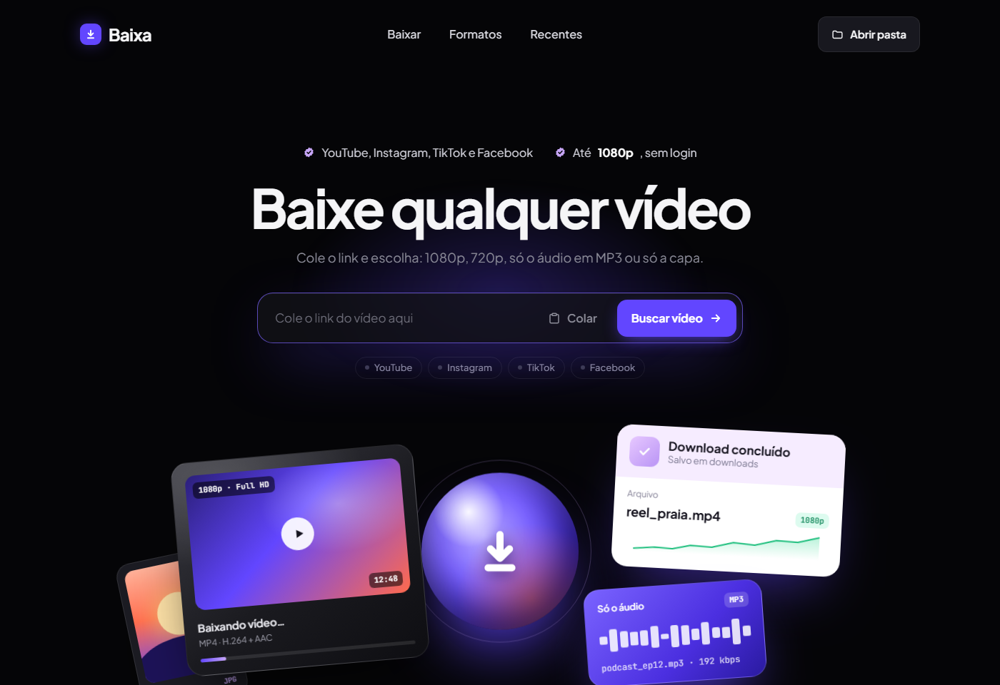

# Baixa — downloader de vídeos que roda no seu computador

Baixe vídeos do **YouTube, Instagram, TikTok e Facebook** em **1080p** ou **720p**, só o **áudio (MP3)** ou só a **capa (JPG)**.
Tudo roda na sua máquina: sem login, sem servidor de terceiros, sem anúncios.



## Instalação (Windows)

### 1. Instale os pré-requisitos (uma vez só)

Abra o **PowerShell** e rode:

```powershell
winget install Python.Python.3.12
winget install Gyan.FFmpeg
winget install OpenJS.NodeJS.LTS
```

Feche e abra o PowerShell de novo depois de instalar.

| Programa | Para que serve |
|----------|----------------|
| Python 3.10+ | roda o app |
| ffmpeg | junta vídeo e áudio, converte para MP3, gera a capa em JPG |
| Node.js | o YouTube exige um "runtime JavaScript" para liberar os vídeos |

### 2. Baixe o projeto

Clique em **Code → Download ZIP** aqui no GitHub e extraia numa pasta, ou use o git:

```powershell
git clone https://github.com/Bogo0400/baixa-videos.git
```

### 3. Abra

Dê dois cliques em **`iniciar.bat`**. Na primeira vez ele instala as dependências sozinho (leva um minuto).
O navegador abre em `http://127.0.0.1:5055`.

Para desligar, feche a janela preta do `iniciar.bat`.

## Mac e Linux

Instale Python 3, ffmpeg e Node.js pelo gerenciador do seu sistema (ex.: `brew install python ffmpeg node`) e rode:

```bash
python3 -m venv .venv
.venv/bin/pip install -r requirements.txt
.venv/bin/python app.py
```

O botão **Abrir pasta** só funciona no Windows; no Mac/Linux os arquivos ficam na pasta `downloads` do projeto.

## Como usar

1. Cole o link do vídeo (ou clique em **Colar**) e depois em **Buscar vídeo**.
2. Escolha **1080p**, **720p**, **Só o áudio** ou **Só a capa**.
3. Clique em **Baixar**. O arquivo vai para a pasta de Downloads do navegador **e** fica guardado na pasta `downloads` do projeto.

## Formatos

| Opção      | Arquivo | Observação |
|------------|---------|------------|
| 1080p      | MP4 (H.264 + AAC) | Se o vídeo não tiver 1080p, vem na maior resolução disponível (o app avisa, ex.: "Máx. 576p aqui"). |
| 720p       | MP4 (H.264 + AAC) | Arquivo menor. |
| Só o áudio | MP3 192 kbps | |
| Só a capa  | JPG | Na maior resolução que a plataforma oferece. |

Os vídeos sempre saem em **H.264**, que abre em qualquer player, celular, WhatsApp e editor (Premiere, CapCut etc.).
Quando a plataforma só entrega outro codec (VP9/AV1), o app converte sozinho.

Em vídeos verticais (Reels, TikTok, Shorts), "1080p" significa 1080 de largura (1080×1920).

## Quando algo parar de funcionar

As plataformas mudam com frequência e o motor de download ([yt-dlp](https://github.com/yt-dlp/yt-dlp)) é atualizado quase toda semana.
Se um site parar de baixar:

1. Feche o Baixa.
2. Dê dois cliques em **`atualizar.bat`** (Mac/Linux: `.venv/bin/pip install -U -r requirements.txt`).
3. Abra de novo.

### Instagram/Facebook pedindo login

Alguns vídeos só abrem para quem está logado. Nesse caso:

1. Instale no navegador a extensão **"Get cookies.txt LOCALLY"**.
2. Entre no Instagram/Facebook, clique na extensão e exporte os cookies.
3. Salve o arquivo com o nome **`cookies.txt`** dentro da pasta do projeto.
4. Reinicie o Baixa.

> O `cookies.txt` dá acesso à sua conta. **Nunca compartilhe esse arquivo** nem suba para o GitHub (ele já está no `.gitignore`).

### Outras mensagens

- **"Bloqueado para a sua região"** — o dono do vídeo restringiu o acesso por país.
- **"Esse vídeo é privado"** — só dá para baixar vídeos públicos.
- **Aviso "Falta instalar: ffmpeg / Node.js"** no topo da página — volte ao passo 1 da instalação.

## Por que não tem versão online?

De propósito. Serviços na nuvem (Vercel, Render etc.) não servem para isso: o YouTube e as redes sociais bloqueiam
downloads vindos de servidores, e as hospedagens grátis não entregam arquivos de centenas de MB.
Rodando no seu computador, tudo funciona e nenhum arquivo passa por terceiros.

## Estrutura

```
baixa-videos/
├── iniciar.bat        abre o app (Windows)
├── atualizar.bat      atualiza o motor de download (yt-dlp)
├── app.py             servidor local (Flask + yt-dlp)
├── static/index.html  interface
├── requirements.txt
└── downloads/         arquivos baixados (criada ao abrir)
```

## Uso responsável

Baixe apenas conteúdo seu ou que você tenha permissão de baixar, e respeite os termos de uso de cada plataforma
e os direitos dos criadores. Cada pessoa é responsável pelo uso que faz da ferramenta.

## Licença

[MIT](LICENSE)
